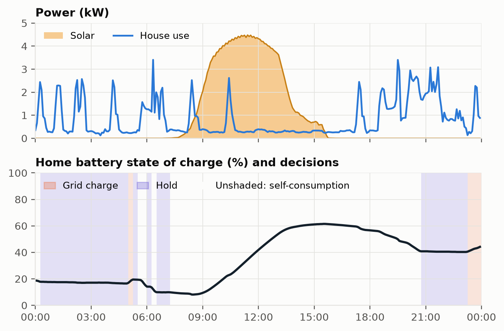
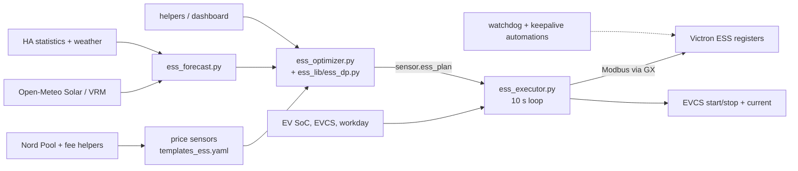

# Victron ESS + EV charging optimizer for Home Assistant

Price- and forecast-driven control of a **Victron ESS** home battery and a **Victron EV Charging Station** from Home Assistant, using model predictive control:

1. **Forecast** solar production and house load per 15-minute quarter for today, tomorrow and the day after (every hour).
2. **Plan** the battery (and the EV) per quarter up to the end of the published Nord Pool prices with dynamic programming, minimising import cost − export revenue + battery wear (every 15 min).
3. **Execute** the current quarter through the Victron ESS Modbus registers and the EV charger (every 10 s), with watchdogs that hand control back to plain Victron self-consumption if anything stalls.

This is a **reference implementation** taken from a running system (Sweden, SE3, quarter-hour prices), not a turnkey integration. Expect to adapt entity IDs, prices and limits to your installation. See [docs/installation.md](docs/installation.md).

## What it does

* Serves the house from the battery as much as possible; buys grid energy only when and as much as it pays (cheap-quarter charging, holding the battery for price peaks).

* Sells only surplus that solar will refill, never the night reserve; optional spike rule sells in any quarter above a price threshold.

* Charges the EV in the cheapest quarters before workday departures, with a temperature-dependent target, a deadline guard and optional cabin preheat fed from the grid.

* Guest charging: other cars are charged from the grid (never from the house battery), with a per-session cost counter.

* Power-dependent efficiency model fitted on measured data (inverter/charger losses), full-charge SoC sync every 14 days, main-fuse protection.

## Results (author's system)

| Evaluation                                             | Result vs plain Victron self-consumption    |
| ------------------------------------------------------ | ------------------------------------------- |
| Live, 10 days of high prices (Nov 2026, 3–7.7 SEK/kWh) | ≈ +166 SEK (13 %)                           |
| Live, cold week with little sun (Oct 2026)             | ≈ +40 SEK/week                              |
| Backtest Jan–Sep 2026, realistic forecasts             | +5 % (+442 SEK); perfect forecasts +782 SEK |
| Weeks with small price spreads                         | ≈ 0                                         |

The optimizer's gain over self-consumption is modest; it grows with price spread. PV + battery as such saved ≈ 12 300 SEK/year on this system. Details: [docs/results.md](docs/results.md).

## Architecture

| Component         | File                                | Role                                                                     |
| ----------------- | ----------------------------------- | ------------------------------------------------------------------------ |
| Price sensors     | `ha/templates_ess.yaml`             | Real import/export price per quarter (spot + fees + VAT)                 |
| Forecasts         | `ha/pyscript/ess_forecast.py`       | PV, temperature-corrected load, forecast accuracy, EV learning           |
| Optimizer core    | `ha/ess_lib/ess_dp.py`              | Dynamic programming, plain Python (also usable offline)                  |
| Optimizer         | `ha/pyscript/ess_optimizer.py`      | Collects inputs, runs the core (~1 s), publishes `sensor.ess_plan`       |
| Executor          | `ha/pyscript/ess_executor.py`       | Battery registers and EV charger; `sensor.ess_executor`, `sensor.ess_ev` |
| Guest counter     | `ha/pyscript/ess_guest.py`          | Energy and grid cost of guest charging                                   |
| Helpers           | `ha/packages/ess_helpers.yaml`      | All settings (64 helpers)                                                |
| Automations       | `ha/automations_ess.yaml`           | Watchdog, DST keepalive, automatic guest mode                            |
| Dashboard         | `ha/dashboards/energi-ess.yaml`     | Overview, Plan, Guest, Tuning, Diagnostics                               |
| Integration patch | `patches/hass-victron-v0.6.4.patch` | Fixes needed in the Victron Modbus integration                           |

## Requirements

* Victron ESS (Multi/Quattro + GX) with Modbus TCP enabled; ESS mode "Optimized" (with or without BatteryLife).

* Home Assistant 2025.x or newer with [Pyscript](https://github.com/custom-components/pyscript) (HACS), [Victron GX Modbus TCP](https://github.com/sfstar/hass-victron) (HACS, write access enabled), [Nord Pool](https://github.com/custom-components/nordpool) (HACS, 15-min prices), a PV forecast ([Open-Meteo Solar Forecast](https://github.com/rany2/ha-open-meteo-solar-forecast) or the core Victron VRM integration), Workday, a weather entity, [apexcharts-card](https://github.com/RomRider/apexcharts-card) for the dashboard.

* Optional: Victron EVCS (controlled through the GX), an EV integration that exposes the car's SoC, a grid meter (P1/HAN) for guest-charging cost.

## Documentation

| Doc                                       | Content                                    |
| ----------------------------------------- | ------------------------------------------ |
| [installation.md](docs/installation.md)   | Step-by-step setup and safe commissioning  |
| [configuration.md](docs/configuration.md) | Entities to map, helper reference values   |
| [prices.md](docs/prices.md)               | Price model and how to adapt it            |
| [forecasts.md](docs/forecasts.md)         | PV and load forecasts                      |
| [optimizer.md](docs/optimizer.md)         | DP model, selling rules, reserve, SoC sync |
| [executor.md](docs/executor.md)           | Modes and Victron register writes          |
| [ev-charging.md](docs/ev-charging.md)     | Smart EV charging, preheat, guest mode     |
| [safety.md](docs/safety.md)               | Fallbacks and watchdogs                    |
| [operations.md](docs/operations.md)       | Pitfalls, integration patches, maintenance |
| [results.md](docs/results.md)             | Measured and simulated results             |

## Disclaimer

This software writes to your inverter's control registers. A bug or wrong setting can drain or overcharge the battery from the grid, export energy, or leave the EV uncharged. Commission it step by step, watch it closely during the first days, and keep `ess_mode = Victron default` as the way back. No warranty (MIT license).
