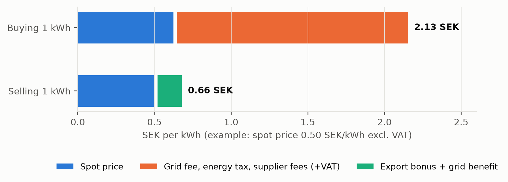

# Prices

The optimizer works on the **real marginal price** per quarter, not the spot price. `ha/templates_ess.yaml` builds two sensors from the Nord Pool sensor (spot incl. VAT) and fee helpers (öre/kWh excl. VAT, from your invoice):

- **Import** `sensor.ess_import_price` = `(S / (1 + VAT) + grid fee + energy tax + supplier variable + markup + peak fee) × (1 + VAT)`
- **Export** `sensor.ess_export_price` = `S / (1 + VAT) + export bonus + grid benefit` (no VAT on private export in Sweden)

Both carry `today` / `tomorrow` arrays (96 quarters/day, 92/100 on DST days), which the optimizer reads. The HA energy dashboard can use them too.

**After changing a fee helper, call `template.reload`**: the fees are read through template `variables`, which do not re-render when a helper changes.

## Author's values (SE3, 2026)

| Component | öre/kWh excl. VAT |
| --- | --- |
| Grid transfer | 73.40 |
| Energy tax | 36.00 |
| Supplier variable costs (monthly) | 5.32 |
| Supplier markup | 6.00 |
| Export: supplier bonus / grid benefit | +10.00 / +5.86 |

Result: import ≈ spot + 1.51 SEK/kWh, export ≈ spot excl. VAT + 0.16 SEK/kWh.

## What this means for control

- Import costs ≈ 1.35 SEK/kWh + 20 % of spot more than export pays at the same spot price, so **self-consumption is worth the most**.
- Buying to resell never pays.
- Shifting grid energy in time pays only when the spread exceeds the round-trip losses on the full import price plus wear (≈ 0.4 SEK/kWh here).
- Selling pays only for energy that solar refills.

## Adapting

- Other price area or currency: change the Nord Pool entity and the `1.25` divisor (VAT) in the templates.
- No VAT on spot in your sensor: drop the division.
- Power tariff: `ess_peak_hour_fee` adds a flat per-kWh fee; a real peak-demand charge is not modelled.
