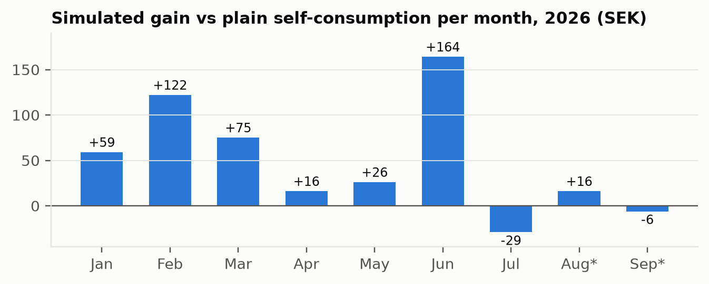
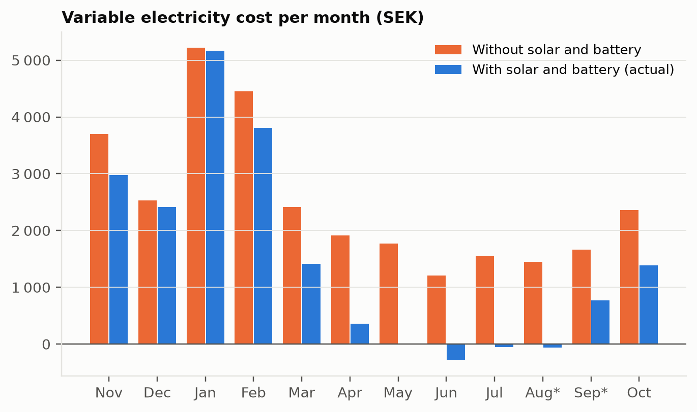
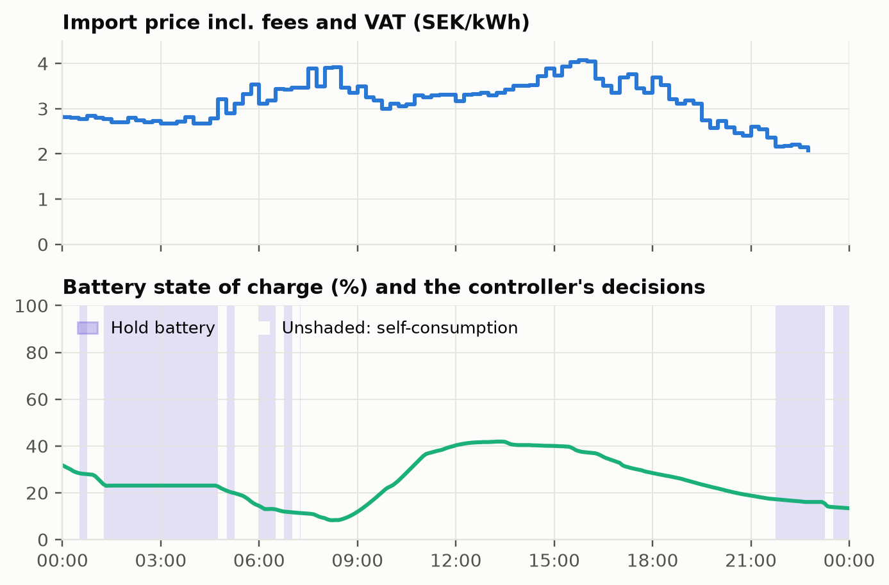
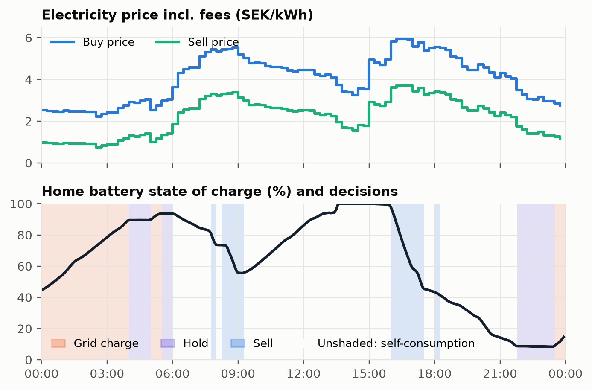
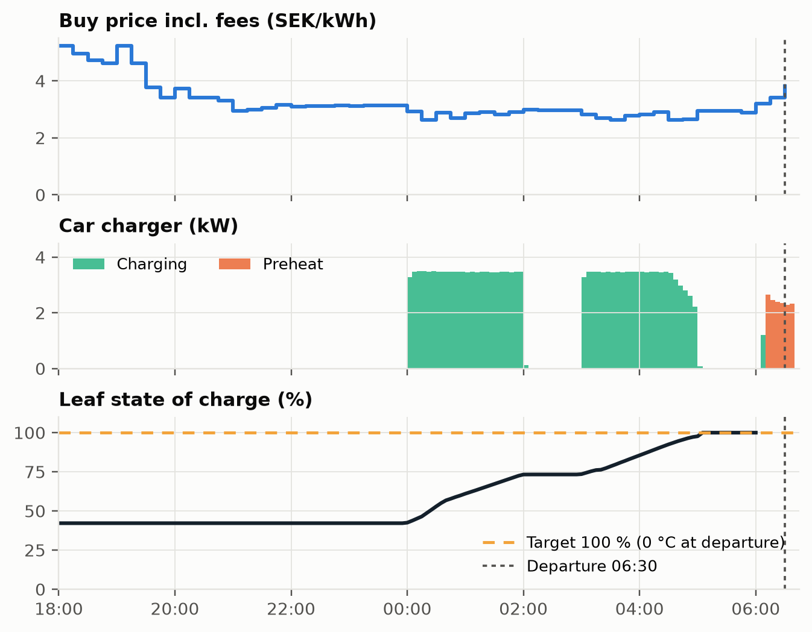
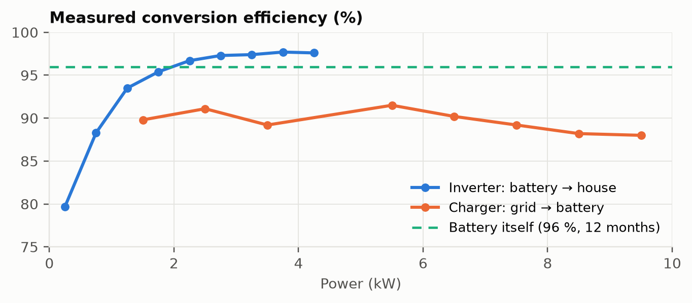

# Results (author's system)

System: 3-phase Victron Multi ~12 kW, 28 kWh LiFePO4 (29 kWh measured), 6.0 kWp AC-coupled roof PV + 3.2 kWp DC wall PV, 16 A main fuse, Nissan Leaf 30 kWh on a Victron EVCS, SE3 quarter-hour prices, selling mostly off.

| Evaluation | Result vs plain self-consumption |
| --- | --- |
| Live, 2026-11-03..12 (high prices 3–7.7 SEK/kWh, spike selling at 4.0) | Measured 1 151 SEK vs simulated self-consumption 1 317: **≈ +166 SEK (13 %)**, same start/end SoC. Paid 3.42 SEK/kWh on average vs 4.10 time-average |
| Live, 2026-10-09..16 (cold, little sun) | ≈ +40 SEK/week |
| Live, 2026-10-20..24 (small spreads) | ≈ 0 |
| Backtest Jan–Sep 2026 (239 days, realistic forecasts) | +442 SEK (5 %); perfect forecasts +782 SEK |
| Summer half-year with selling (Apr–Oct, simulated) | +315 SEK realistic, mainly May–June; without selling ≈ 0 |
| Measured vs constant efficiency model | +0.4–2 SEK per 10 days; night SoC RMSE 2.8 % vs 4.1 % |
| Hardware scenarios | +50 % PV ≈ +3 000 SEK/year; +14 kWh battery ≈ +300 SEK/year: energy, not storage, is the bottleneck |

Takeaways: the gain grows with price spread; winter is driven by consumption; a forecast-driven plan earns most from charging in cheap quarters and holding the battery for price peaks, and from avoiding losses the old rule-based automations made in winter.

## Simulated gain per month (backtest)

## PV + battery vs no PV/battery (one year)

≈ 12 300 SEK/year variable cost saved (PV ≈ 8 500, battery ≈ 3 800). Aug–Sep have a statistics gap and are scaled.

## Example days

A winter day: the battery is held through cheap night hours and used in the price peaks.

Selling into an evening price peak:

An EV night: charging in the cheapest quarters before the departure, with preheat:

Measured inverter/charger efficiency vs power:

